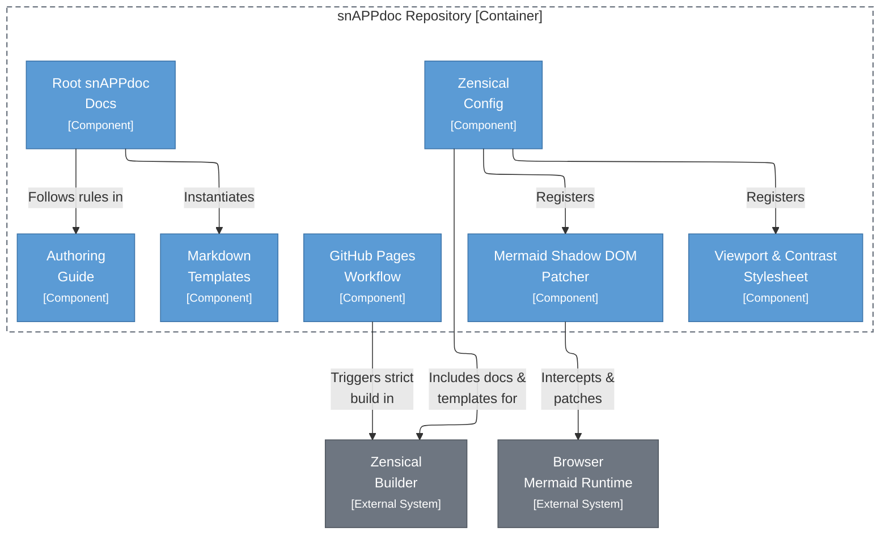
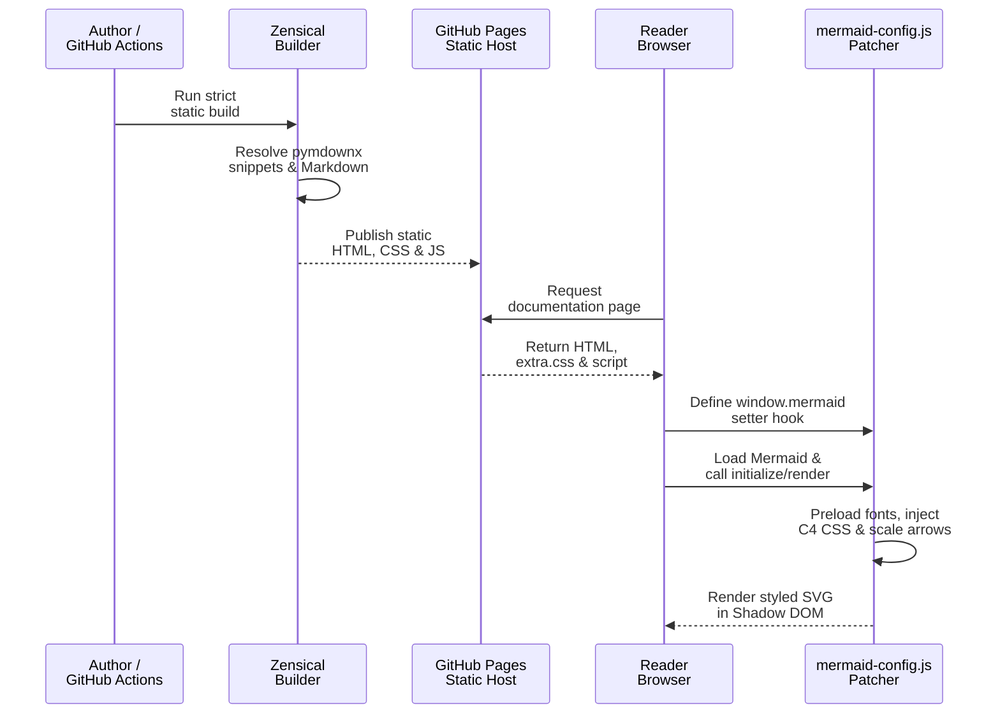
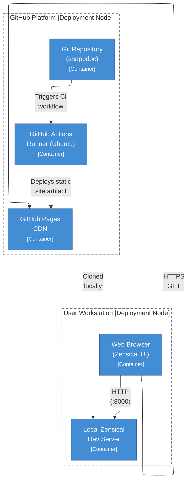

# Architecture

snAPPdoc combines a static collection of modular Markdown templates with a lightweight Zensical build configuration and a zero-dependency client-side Mermaid enhancement layer. Documentation content is authored once in modular files and assembled into overview and single-page arc42 views at static build time via `pymdownx.snippets`.

## Solution Strategy

<!-- --8<-- [start:solution-strategy] -->
Keep documentation authoring strictly in plain Markdown while elevating visual presentation and cross-page reuse through standard Zensical extensions and a drop-in CSS/JS layer.

- **Modular templates with strict optionality:** Provide 5 required templates and 8 optional templates so every component stays uniform without empty stub pages.
- **Build-time single-source assembly:** Use `pymdownx.snippets` markers (`--8<--`) to share the System Context diagram (`purpose.md` → `README.md`) and compile `arc42.md` from modular pages without duplicating prose.
- **ELK-backed C4 diagrams:** Standardize on Mermaid `flowchart TB` with ELK layout and reusable C4 classes instead of Mermaid's native `C4*` diagrams for cleaner edge routing.
- **Closed Shadow DOM interception:** Patch `window.mermaid` before Zensical initializes it so custom C4 CSS, font synchronization, wrapping widths, and arrowhead scaling apply inside Zensical's closed Shadow DOM.
<!-- --8<-- [end:solution-strategy] -->

## Components

<!-- --8<-- [start:components] -->

### Component implementations

- **Root snAPPdoc Docs** ([`README.md`](README.md), [`purpose.md`](purpose.md), [`functionality.md`](functionality.md), [`operate.md`](operate.md), [`develop.md`](develop.md), [`architecture.md`](architecture.md), [`arc42.md`](arc42.md), [`glossary.md`](glossary.md)): Apply snAPPdoc recursively to itself as both project documentation and a live reference implementation.
- **Authoring Guide** ([`guide.md`](guide.md)): Defines the required-vs-optional matrix, writing style, modular `specs/` conventions, C4 diagram standards, and arc42 assembly rules.
- **Markdown Templates** ([`templates/`](templates/README.md)): Thirteen copy-ready blueprints (5 required, 8 optional including [`specs/topic-spec.md`](templates/specs/topic-spec.md)) with inline blockquote examples and snippet markers.
- **Zensical Config** ([`zensical.toml`](zensical.toml)): Configures site navigation, Material light/dark palettes, `exclude_docs` (including `!templates/`), Markdown extensions (`pymdownx.snippets`, `pymdownx.superfences`), and custom static assets.
- **Viewport & Contrast Stylesheet** ([`stylesheets/extra.css`](stylesheets/extra.css)): Expands `.md-grid` to full viewport width and aligns Mermaid edge/label colors with active theme foreground tokens.
- **Mermaid Shadow DOM Patcher** ([`javascripts/mermaid-config.js`](javascripts/mermaid-config.js)): Intercepts `window.mermaid` via `Object.defineProperty`, injects C4 `themeCSS`, synchronizes layout fonts and wrapping widths (`400px`), waits for web fonts before rendering, and scales `userSpaceOnUse` SVG `<marker>` arrowheads by `1.5×`.
- **GitHub Pages Workflow** ([`.github/workflows/docs.yml`](.github/workflows/docs.yml)): Validates strict Zensical builds on pull requests and deploys `site/` to GitHub Pages on pushes to `main` or manual dispatch.

### Domain objects

- **Documentation Template** ([`templates/`](templates/README.md)): Source blueprint files copied by adopting teams.
- **Component Documentation Set** ([`README.md`](README.md)): Instantiated set of modular Markdown files for one system or nested component.
- **Snippet Marker** (`<!-- --8<-- [start:<name>] -->`): Named content range defined in [`purpose.md`](purpose.md), [`functionality.md`](functionality.md), [`architecture.md`](architecture.md), and [`glossary.md`](glossary.md) and consumed by [`README.md`](README.md) and [`arc42.md`](arc42.md).
- **Single-Page arc42 View** ([`arc42.md`](arc42.md)): Pure include-based assembly of the 12 standardized arc42 sections.
<!-- --8<-- [end:components] -->

## Runtime

<!-- --8<-- [start:runtime] -->

Runtime execution splits into two phases:

1. **Static build phase:** Zensical runs `pymdownx.snippets` before Markdown parsing to inline shared sections (such as `purpose.md:system-context` in `README.md` and all 12 sections in `arc42.md`), preserves Mermaid code blocks as `<pre class="mermaid">`, and emits static HTML, CSS, and JavaScript.
2. **Browser render phase:** `javascripts/mermaid-config.js` registers a property interceptor on `window.mermaid` before Zensical loads Mermaid, wraps `initialize` (injecting C4 `themeCSS`, computed body font, `wrappingWidth: 400`, and `padding: 20`), and wraps `render` (awaiting `document.fonts` up to 1.5 s and scaling `userSpaceOnUse` SVG arrow markers by `1.5×`).
<!-- --8<-- [end:runtime] -->

## Deployment

<!-- --8<-- [start:deployment] -->

- **Production:** Hosted as a static GitHub Pages site built on Ubuntu GitHub Actions runners with Python 3.12 and Zensical `>=0.1,<0.2` (see [Operate](operate.md#deployment-lifecycle)).
- **Local Preview:** Authors run `zensical serve` locally on port `8000` with live reload (see [Develop](develop.md#running-locally)).
<!-- --8<-- [end:deployment] -->

## Concepts

<!-- --8<-- [start:concepts] -->
### Single Source of Truth (`pymdownx.snippets`)

Shared diagrams and cross-cutting architecture sections are authored once inside named `<!-- --8<-- [start:<name>] -->` / `<!-- --8<-- [end:<name>] -->` ranges. Both `README.md` (System Context diagram) and `arc42.md` (all 12 sections) include those ranges at build time, eliminating duplicate editing. Cross-section links always specify explicit filenames (e.g., `architecture.md#architecture-decisions`) so anchors resolve identically in modular pages and inside `arc42.md`.

### Closed Shadow DOM Mermaid Enhancement

Zensical isolates rendered Mermaid SVGs inside a closed Shadow DOM, preventing external page stylesheets from styling nodes or lines. `javascripts/mermaid-config.js` solves this by intercepting `window.mermaid` at script load time, injecting C4 node/boundary rules into Mermaid's `themeCSS`, aligning layout fonts and `wrappingWidth` (`400px`) with `document.body` to prevent Mermaid 12's narrow `120px` clipping bug at non-100% zoom/DPR, and post-processing rendered SVG `<marker>` elements so arrowheads remain legible.

### Nested Consistency & Optional Omission

The same file taxonomy applies at the repository root and recursively inside every component directory (`services/<name>/`, `libs/<name>/`). Only the 5 core files are mandatory; optional files (`api.md`, `events.md`, `ui.md`, `db.md`, `operate.md`, `specs/*.md`, `arc42.md`, `glossary.md`) are copied only when applicable and omitted completely—including from `README.md` and `zensical.toml`—when not needed.

### Dual Readability

Templates avoid custom syntax beyond standard Markdown, Mermaid fences, and HTML-comment snippet markers so pages remain cleanly readable directly in GitHub and VS Code without requiring a running site builder.
<!-- --8<-- [end:concepts] -->

## Risks

<!-- --8<-- [start:risks] -->
1. **Upstream Zensical or Mermaid breaking changes (High × Medium):** Zensical `0.1.x` or future Mermaid releases could alter how `window.mermaid` is initialized, how Shadow DOM styling is scoped, or how ELK layouts behave. *Mitigation:* Pin `zensical>=0.1,<0.2` in CI, guard all patcher hooks with defensive feature checks (`__snappdocPatched`, `try/catch` fallbacks), and run strict builds on every PR.
2. **Snippet preprocessor stripping illustrative prose or templates (Medium × Medium):** `pymdownx.snippets` runs before Markdown parsing and strips bare `--8<-- "..."` lines (even inside fenced code blocks) as well as any line containing a literal `[start:<valid-name>]` marker. *Mitigation:* Enable `check_paths = true` in `zensical.toml`, wrap illustrative template directives in inline backticks, and use generic `<name>` placeholders when mentioning marker syntax in prose (see [Develop](develop.md#testing-quality-checks)).
3. **Drift between templates, guide, and root docs (Medium × Medium):** Updating a template without updating `guide.md`, `zensical.toml`, or root dogfooded docs creates conflicting guidance. *Mitigation:* Follow the sync checklist in [Develop](develop.md#workflow-conventions) and treat the root docs as the live reference implementation.
4. **Accidental exclusion of `templates/` by Zensical (Low × Medium):** Zensical ignores top-level `templates/` directories by default, which would silently drop the template reference from Pages. *Mitigation:* Document and preserve `!templates/` and `!templates/**` in `zensical.toml` and cover recovery in [Operate](operate.md#troubleshooting).
<!-- --8<-- [end:risks] -->

## Architecture Decisions

<!-- --8<-- [start:architecture-decisions] -->
- **Plain Markdown + Zensical over heavyweight docs frameworks:** Keeps documentation copy-pasteable and directly readable in GitHub and VS Code while still delivering full-text search, dark mode, and static Pages publishing with a single TOML config.
- **Mermaid `flowchart TB` with ELK layout over native Mermaid `C4*` diagrams:** ELK routes edges cleanly around boundary boxes and prevents overlapping labels, while custom `classDef` classes (`c4System`, `c4Container`, `c4Component`, `c4Db`, `c4External`, `c4Boundary`) retain C4 visual semantics.
- **Snippet-based assembly (`pymdownx.snippets`) over duplicated prose:** Lets teams maintain modular component pages day-to-day while still producing an up-to-date single-page [arc42](arc42.md) deliverable and keeping `README.md` diagrams synchronized with `purpose.md`.
- **Vanilla ES5 `window.mermaid` interception over custom Zensical fork or bundler:** Works around Zensical's closed Shadow DOM without requiring Node.js, npm packages, or maintaining a forked static site generator.
- **Omit non-applicable optional files instead of stubbing:** Prevents documentation rot and reader noise by forbidding empty *"Not applicable"* files—demonstrated in snAPPdoc itself by omitting `api.md`, `events.md`, `ui.md`, `db.md`, and `specs/`.
- **Publish `templates/` alongside live docs with `invalid_links = false` and `check_paths = true`:** Allows visitors to browse the raw template blueprints directly on the snAPPdoc Pages site while still enforcing build-time validation of every live `pymdownx.snippets` include in `README.md` and `arc42.md`.
<!-- --8<-- [end:architecture-decisions] -->
