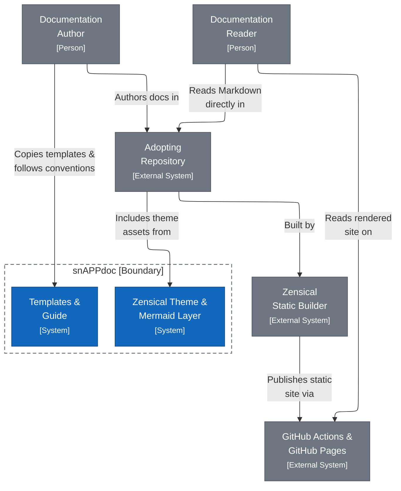

# snAPPdoc (Documentation Template Collection)

<!-- --8<-- [start:overview] -->
**snAPPdoc** (*Simple Nested Application Documentation*) is a lightweight, reusable Markdown documentation template collection with companion Zensical theme and Mermaid rendering enhancements. It provides a consistent set of modular documentation files that apply recursively at the application root and inside every nested component (`services/`, `libs/`, etc.) without custom generators or heavyweight tooling.
<!-- --8<-- [end:overview] -->

## Goals

<!-- --8<-- [start:goals] -->
- **Consistent nested structure:** Enable teams to document both top-level systems and every nested service, frontend, or library with the same predictable file layout.
- **Zero empty boilerplate:** Keep documentation lean by separating 5 required core files from optional files that are omitted whenever they do not apply.
- **Single source of truth:** Eliminate prose and diagram drift across component overviews (`README.md`), modular pages, and single-page [arc42](https://arc42.org/) views through reusable snippet markers.
- **Readable everywhere:** Ensure every page renders cleanly as raw Markdown on GitHub and in VS Code while building with zero warnings into a searchable static site using [Zensical](https://zensical.org/).
- **Readable C4 diagrams in light and dark mode:** Deliver legible, non-overlapping architecture diagrams with consistent C4 styling across both light and dark themes.
<!-- --8<-- [end:goals] -->

## System Context

<!-- --8<-- [start:context-and-scope] -->
<!-- --8<-- [start:system-context] -->

<!-- --8<-- [end:system-context] -->

- **Documentation Author → Templates & Guide:** Copies applicable Markdown templates and follows the authoring conventions in [Authoring Guide](guide.md) when documenting an application or component.
- **Documentation Author → Adopting Repository:** Maintains modular Markdown files at the repository root and inside nested component folders.
- **Adopting Repository → Zensical Theme & Mermaid Layer:** References the companion stylesheet and Mermaid enhancement script for full-width layouts and C4 diagram styling.
- **Adopting Repository → Zensical Static Builder:** Compiles Markdown, snippet includes, and theme assets into a searchable static HTML site.
- **Zensical Static Builder → GitHub Actions & GitHub Pages:** Validates strict builds on pull requests and publishes the static output on pushes to `main`.
- **Documentation Reader → GitHub Pages / Adopting Repository:** Consumes either the published static site or raw Markdown files directly in GitHub and VS Code.
<!-- --8<-- [end:context-and-scope] -->

## Constraints

<!-- --8<-- [start:constraints] -->
- **Plain Markdown first:** Templates must remain directly readable and editable in GitHub and VS Code without proprietary authoring formats or custom Markdown parsers ([Architecture Decisions](architecture.md#architecture-decisions)).
- **Zensical `0.1.x` compatibility:** Configuration, Markdown extensions, and theme overrides target [Zensical](https://zensical.org/) `>=0.1,<0.2` and its default closed Shadow DOM Mermaid rendering ([Operate](operate.md#configuration-secrets)).
- **Zero-dependency client enhancement:** Browser-side Mermaid styling and layout fixes must run as vanilla ES5-compatible JavaScript with no build step or bundler ([Architecture Decisions](architecture.md#architecture-decisions)).
- **License & arc42 attribution:** The repository is MIT-licensed, while the optional `arc42.md` template and view must retain the [arc42](https://arc42.org/) CC BY-SA 4.0 structural attribution notice.
- **GitHub Pages static hosting:** Published output must be purely static assets deployable via standard GitHub Actions Pages workflows without server-side runtime state.
<!-- --8<-- [end:constraints] -->
